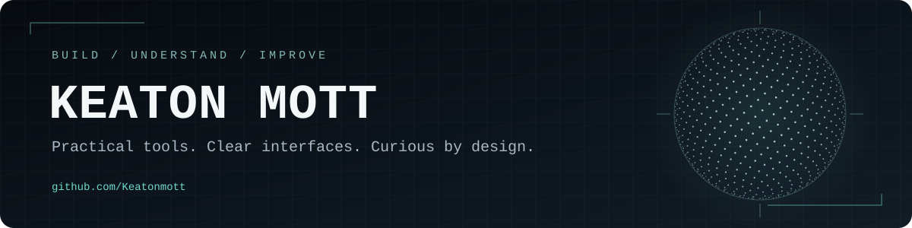

  

  <strong>Defensive security · Windows tooling · Learning through code</strong>

  <a href="https://github.com/Keatonmott?tab=repositories">Explore my repositories</a>
  &nbsp; / &nbsp;
  <a href="https://github.com/Keatonmott/ProjectEverything">Try PyQuest</a>

## Hi, I'm Keaton

I build tools that make computers easier to understand and everyday technical work easier to do. My interests center on **defensive cybersecurity, Windows utilities, automation, and interactive ways to learn programming**.

This is where I'll share the projects, scripts, and experiments I develop—along with setup instructions, examples, and notes on what I learned along the way.

## On the workbench

| Project | What it does | Status |
| :--- | :--- | :--- |
| **[PyQuest](https://github.com/Keatonmott/ProjectEverything)** | A terminal game for learning Python, data structures, and algorithms. Lessons, coding challenges, tests, and visualizations show how code changes memory and processes data. | **Published** in `ProjectEverything` |
| **Atlas** | A native Windows filesystem manager with a dark interface, keyboard navigation, nested action menus, markers for batch operations, and adjustable text and layout. | **Working local prototype** · repository planned |
| **Defensive tools & scripts** | Small utilities for system inspection, repeatable defensive workflows, and automation in authorized environments. | **Planned additions** |

### Atlas: the direction

Atlas starts with a simple idea: managing files should feel clear and intuitive. The current prototype supports moving, copying, renaming, search, action history, and eligible undo operations in a single navigable tree.

I'm developing it toward a more complete desktop product. **Compression, encryption, and a guided walkthrough are future features**, not capabilities of the current build.

## What I'll be posting

- **Windows tools** — practical desktop applications and filesystem utilities, with screenshots and usage examples.
- **Defensive security scripts** — focused tools with a clear purpose, setup steps, and documented limitations.
- **Automation & lab notes** — repeatable workflows and explanations of how things work.
- **Learning experiments** — interactive projects that make programming concepts easier to see and practice.

## How I build

**Python** for tools and learning projects · **C# / .NET** for Windows applications · **PowerShell** for automation · **Git** for version control.

I combine hands-on development with AI-assisted coding, then review and test the results. I care about understandable interfaces, useful documentation, and being clear about what works today versus what is still in progress.

---

Build something useful. Understand how it works. Keep improving it.

